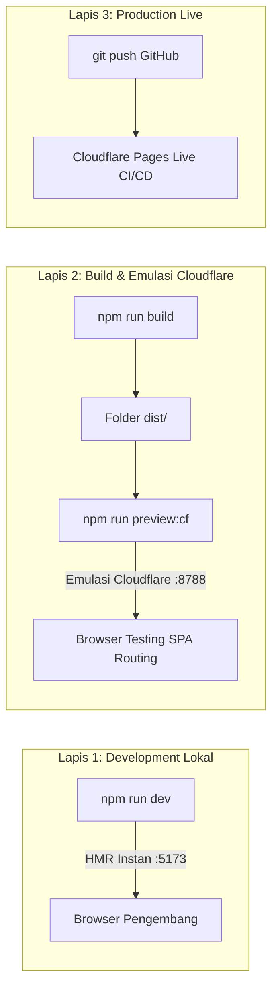

# Development Plan: Portal Resmi Yayasan Griya Mahir Al-Qur'an (GMQ)

**Lembaga:** Yayasan Griya Mahir Al-Qur'an (YGMQ)  
**Tech Stack:** Vite 6 + React 19 (TypeScript) | Supabase (PostgreSQL + Auth + Storage) | Cloudflare Pages  
**Target:** 100% Free-Tier, Ringan (<180KB gzip bundle), Modular, Offline/Mock-Ready untuk pengujian lokal instan.  
**Palet Brand (Revisi Prestige Islamic):**
- **Hijau Zamrud Primer (60% Dominan):** `#6EA81A`, `#245E17`, `#173D0E` — Identitas dakwah Al-Qur'an, kedamaian, dan kesegaran.
- **Emas Mulia / Kuning (25% Aksen):** `#FAC300`, `#D6A500` — Kemuliaan, tombol CTA pendaftaran/infaq (`.btn-gold`), nomor rekening BSI, dan kartu keunggulan.
- **Biru Safir (15% Jangkar & Wibawa):** `#204D74`, `#133451` — Tipografi judul, struktur kartu formal, dan penyeimbang kontras profesional.

---

## 1. Strategi Pengujian Lokal (Local Testing Strategy)

Untuk memastikan website dapat dites 100% di komputer lokal sebelum dideploy ke Cloudflare Pages, kita menerapkan 3 lapis pengujian:



### A. Fitur Dual-Mode (Mock Mode vs Live Supabase)
- **Local Mock Mode (Default saat ini):**
  - Seluruh fitur portal publik dan CMS backoffice (CRUD kabar santri, tambah/edit unit pendidikan, kelola pendaftar PSB via WhatsApp direct, dan pengaturan profil yayasan) **100% aktif dan dapat diuji langsung** menggunakan *in-memory / LocalStorage adapter*.
  - Dilengkapi fitur **1-Click Demo Login** (`Superadmin` & `Editor`) di halaman `/admin` sehingga pengujian tidak membutuhkan pengetikan manual.
- **Live Supabase Mode:**
  - Cukup isi file `.env.local` dengan `VITE_SUPABASE_URL` dan `VITE_SUPABASE_ANON_KEY`, aplikasi otomatis beralih menggunakan PostgreSQL & Supabase Auth asli tanpa mengubah kode frontend.

### B. Emulasi Cloudflare Pages di Komputer Lokal
- Menggunakan tool resmi dari Cloudflare: **Wrangler** (`npm run preview:cf`).
- Menguji file konfigurasi `public/_redirects` (agar URL SPA seperti `/admin`, `/berita/:slug`, `/layanan` tidak *404 Not Found* saat di-refresh di browser).
- Menguji performa kompresi build akhir (gzip/brotli) dan aset statis.

---

## 2. Struktur Proyek Terkini

```text
NEW-PORTAL-GMQ/
├── public/
│   ├── _redirects                     # Routing rule Cloudflare Pages (/* / 200)
│   ├── favicon.svg
│   └── assets/                        # Logo GMQ & icon statis
├── src/
│   ├── assets/
│   │   └── Logo_YGMQ_Transparan.png   # Logo resmi Yayasan Griya Mahir Al-Qur'an
│   ├── components/
│   │   ├── common/                    # WhatsAppButton, ScrollToTop
│   │   └── layout/                    # Navbar (Emerald Silk & Gold CTA), Footer (BSI Infaq Card)
│   ├── context/
│   │   └── AuthContext.tsx            # Auth Context, Role (Superadmin/Editor), 1-Click Demo Login
│   ├── data/
│   │   └── mockData.ts                # Seed data unit formal/non-formal, hadits, artikel, profil GMQ
│   ├── hooks/
│   │   ├── usePosts.ts                # CRUD kabar santri & artikel
│   │   ├── useServices.ts             # CRUD unit pendidikan formal & non-formal
│   │   ├── useInquiries.ts            # CRUD pendaftaran santri baru & pesan konsultasi
│   │   └── useSiteConfig.ts           # State konfigurasi identitas & kontak yayasan
│   ├── lib/
│   │   ├── supabase.ts                # Supabase client konektor
│   │   └── adapter.ts                 # Dual-mode data adapter layer (Mock <-> Supabase)
│   ├── pages/
│   │   ├── public/
│   │   │   ├── HomePage.tsx           # Hero emerald silk, 4-stat colorful cards, Hadith banner, PSB section
│   │   │   ├── AboutPage.tsx          # Profil lembaga, framed logo YGMQ, visi-misi, pilar santri
│   │   │   ├── ServicesPage.tsx       # Katalog unit formal & non-formal bersanad muttashil
│   │   │   ├── NewsPage.tsx           # Pusat kabar santri, agenda PSB, filter kategori
│   │   │   ├── NewsDetailPage.tsx     # Baca artikel lengkap, tombol share, kabar terkait
│   │   │   └── ContactPage.tsx        # Kontak sekretariat, formulir pendaftaran, rekening donasi
│   │   └── admin/                     # CMS Backoffice Suite (Fase 4)
│   │       ├── AdminEntryPage.tsx     # Master container, navigasi sidebar, form login & 1-click demo
│   │       ├── AdminDashboardTab.tsx  # Metrik KPI, quick actions, 5 pendaftar terbaru
│   │       ├── AdminPostsTab.tsx      # CRUD kabar santri, auto-slug, toggle publish/draft
│   │       ├── AdminServicesTab.tsx   # CRUD unit pendidikan, kurikulum, fitur keunggulan
│   │       ├── AdminInquiriesTab.tsx  # Inquiry inbox, filter status, WhatsApp Direct sender
│   │       └── AdminSettingsTab.tsx   # Konfigurasi profil yayasan, kontak PSB, medsos, rekening
│   ├── styles/                        # Design tokens & styling
│   ├── types/
│   │   └── index.ts                   # TypeScript interfaces (Post, ServiceItem, Inquiry, SiteConfig, User)
│   ├── App.tsx                        # Navigasi & Routing SPA
│   ├── index.css                      # Sistem tema CSS: .card-prestige, .btn-gold, tokens zamrud/emas
│   └── main.tsx
├── .env.example                       # Template konfigurasi environment
├── .env.local                         # Kredensial lokal (gitignored)
├── DEV_PLAN.md                        # Dokumen perencanaan & milestone aktif
├── PLANNING.md                        # Blueprint arsitektur teknis
├── package.json
├── tsconfig.json
└── vite.config.ts
```

---

## 3. Status Tahapan Pengerjaan (Milestones)

### Fase 1: Setup Proyek & Design System Modern (✅ Selesai)
- [x] Inisialisasi Vite 6 + React 19 + TypeScript + Lucide Icons.
- [x] Inisiasi konfigurasi `_redirects` untuk Cloudflare Pages SPA.
- [x] Konfigurasi skrip `npm run preview:cf` (emulator Cloudflare Wrangler lokal).
- [x] Definisi TypeScript interfaces lengkap di [src/types/index.ts](file:///c:/PROJECT/GMQ/NEW-PORTAL-GMQ/src/types/index.ts).

### Fase 2: Arsitektur Data & Mock Engine (✅ Selesai)
- [x] Definisi Data Adapter Layer terpadu ([src/lib/adapter.ts](file:///c:/PROJECT/GMQ/NEW-PORTAL-GMQ/src/lib/adapter.ts)).
- [x] Konektor Supabase Client ([src/lib/supabase.ts](file:///c:/PROJECT/GMQ/NEW-PORTAL-GMQ/src/lib/supabase.ts)).
- [x] Seed data awal Al-Qur'an GMQ lengkap ([src/data/mockData.ts](file:///c:/PROJECT/GMQ/NEW-PORTAL-GMQ/src/data/mockData.ts)).
- [x] Auth Context & State Management dengan Demo Login 1-klik ([src/context/AuthContext.tsx](file:///c:/PROJECT/GMQ/NEW-PORTAL-GMQ/src/context/AuthContext.tsx)).
- [x] Custom React Hooks terpadu (`usePosts`, `useServices`, `useInquiries`, `useSiteConfig`).

### Fase 3: Pembuatan Halaman Publik Portal Yayasan GMQ (✅ Selesai)
- [x] **Identitas Resmi:** Rebranding menyeluruh menjadi **Yayasan Griya Mahir Al-Qur'an (YGMQ)**.
- [x] **Logo Resmi:** Integrasi [Logo_YGMQ_Transparan.png](file:///c:/PROJECT/GMQ/NEW-PORTAL-GMQ/src/assets/Logo_YGMQ_Transparan.png) dengan drop shadow halus pada Navbar, About, dan Footer.
- [x] **Navbar & Footer:** Hadits HR. Al-Bukhari bertinta emas, katalog unit formal/non-formal, rekening donasi/infaq BSI yayasan (`7188 9900 12`), dan tombol WhatsApp.
- [x] **Hero Section & Multimedia:** Headline Qur'ani, call-to-action PSB, modal pemutar video profil santri GMQ.
- [x] **Katalog Unit Pendidikan (`/layanan`):**
  - **Unit Formal:** Kuttab Tahfidz (Usia 5-12 thn) & Ma'had Tahfidz Boarding School (SMP/SMA).
  - **Unit Non-Formal:** Griya Tahsin Dewasa/Eksekutif, Rumah Tahfidz Balita & Anak (RTBA), Dauroh Bersanad Matan Al-Jazariyyah.
- [x] **Modul Berita & Wawasan (`/berita` & `/berita/:slug`):** Filter topik PSB, wisuda tahfidz, artikel talaqqi mutqin.
- [x] **Modul Profil Yayasan (`/tentang`):** Visi & Misi Qur'ani, pilar sanad muttashil, dan 4 karakter santri.
- [x] **Formulir Pendaftaran & Konsultasi (`/kontak` & Home PSB):** Terhubung langsung ke Data Adapter & LocalStorage mock engine.

### Revisi UI: Tema Lebih Berwarna, Dominan Hijau Zamrud & Elegan (✅ Selesai)
- [x] Gradien sutra zamrud (`--gradient-green-hero`) di seluruh banner publik.
- [x] Komponen kartu prestisius (`.card-prestige`) dengan border multi-warna sutra zamrud dan emas.
- [x] Tombol CTA satin emas (`.btn-gold`) dengan bayangan halus.
- [x] Banner Hadits Rasulullah ﷺ bergaya mushaf sutra zamrud mendalam (`#173d0e` ke `#112d0a`) berbingkai emas.
- [x] Pita statistik warna-warni (30 Juz Zamrud, 5 Unit Emas, 850+ Hijau, 100% Safir).

### Fase 4: CMS Backoffice / Admin Portal (✅ Selesai)
- [x] **Admin Authentication & Dual Login:** Form login kredensial dan tombol 1-Click Demo Testing (`Superadmin` & `Editor`).
- [x] **[AdminDashboardTab.tsx](file:///c:/PROJECT/GMQ/NEW-PORTAL-GMQ/src/pages/admin/AdminDashboardTab.tsx):** Metrik KPI *real-time*, aksi cepat tulis artikel/tambah unit, dan 5 permohonan santri terbaru.
- [x] **[AdminPostsTab.tsx](file:///c:/PROJECT/GMQ/NEW-PORTAL-GMQ/src/pages/admin/AdminPostsTab.tsx):** CRUD lengkap kabar santri, modal editor visual, auto-slug generator, dan toggle publish/draft 1-klik.
- [x] **[AdminServicesTab.tsx](file:///c:/PROJECT/GMQ/NEW-PORTAL-GMQ/src/pages/admin/AdminServicesTab.tsx):** CRUD unit pendidikan formal/non-formal, pemilihan ikon, deskripsi kurikulum, dan daftar poin keunggulan.
- [x] **[AdminInquiriesTab.tsx](file:///c:/PROJECT/GMQ/NEW-PORTAL-GMQ/src/pages/admin/AdminInquiriesTab.tsx):** Kotak masuk pendaftaran PSB, filter status (Baru, Dihubungi, Selesai), modal baca detail, dan **WhatsApp Direct Sender** dengan template sapaan resmi GMQ.
- [x] **[AdminSettingsTab.tsx](file:///c:/PROJECT/GMQ/NEW-PORTAL-GMQ/src/pages/admin/AdminSettingsTab.tsx):** Pembaruan profil yayasan, nomor WhatsApp resmi PSB, alamat kantor, email, media sosial, dan rekening donasi.

### Fase 5: Integrasi Supabase Cloud & Cloudflare Pages Deployment (📋 Terjadwal / Langkah Berikutnya)
- [ ] Sediakan file SQL schema (`supabase/schema.sql`) untuk dieksekusi di Supabase SQL Editor (tabel `posts`, `services`, `inquiries`, `site_settings`, `profiles` beserta RLS policies).
- [ ] Konfigurasi upload cover image ke Supabase Storage Bucket (`gmq-media`).
- [ ] Jalankan testing lokal mode produksi menggunakan Cloudflare emulator Wrangler: `npm run preview:cf`.
- [ ] Setup remote Git CI/CD ke Cloudflare Pages dengan build command `npm run build` dan output directory `dist`.

---

## 4. Riwayat Git Checkpoint & Commit

- **Checkpoint #1:** Commit `df4fa39` & `47bfee8` — *Versi #1 GMQ New Portal (Inisialisasi repo & baseline feature)*.
- **Revisi Desain Tema:** Commit `4ca4efb` — *feat(ui): revisi tema lebih berwarna, dominan hijau zamrud, aksen emas dan biru safir elegan*.
- **Selesai Fase 4:** Commit `b547fbe` — *feat(cms): selesaikan Fase 4 modul admin portal (CRUD berita, unit pendidikan, inquiry PSB, settings, dan dashboard)*.
- **Author Identity:** `ringonoerj <ringonoerj@gmail.com>`.
- **Repository Remote:** `https://github.com/ringonoerj/gmq-new-portal.git`.

---

## 5. Panduan Eksekusi Testing Lokal

1. **Jalankan Mode Pengembangan:**
   ```bash
   npm run dev
   ```
   *Buka `http://localhost:5173` untuk portal publik atau `http://localhost:5173/admin` untuk CMS Backoffice.*

2. **Uji Validasi TypeScript & Build Produksi:**
   ```bash
   npm run build
   ```

3. **Jalankan Emulasi Cloudflare Pages Lokal (Wrangler):**
   ```bash
   npm run preview:cf
   ```
   *Buka `http://localhost:8788` di browser.*
