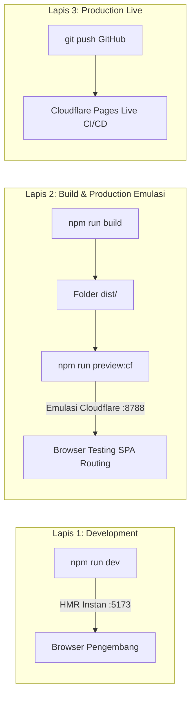

# Development Plan: New GMQ Portal
**Tech Stack:** Vite 6 + React 19 (TypeScript) | Supabase (PostgreSQL + Auth + Storage) | Cloudflare Pages  
**Target:** 100% Free-Tier, Ringan (<150KB bundle), Modular, Dapat dites penuh secara lokal (*offline-ready with mock mode*).  
**Palet Brand:** Blue (`#204D74`), Orange (`#FAC300`), Green (`#6EA81A`).

---

## 1. Strategi Pengujian Lokal (Local Testing Strategy)

Untuk memastikan website dapat dites 100% di komputer lokal sebelum dideploy ke Cloudflare Pages, kita menerapkan 3 lapis pengujian:



### A. Fitur Dual-Mode (Mock Mode vs Live Supabase)
- **Local Mock Mode (Default saat belum setup Supabase):**
  - Website langsung bisa dijalankan dan dites fiturnya (CRUD artikel, filter layanan, submit kontak, login demo admin) menggunakan data mockup di *in-memory / LocalStorage*.
  - Tidak memblokir pengembangan jika koneksi internet terputus atau kredensial Supabase belum dibuat.
- **Live Supabase Mode:**
  - Cukup isi file `.env.local` dengan `VITE_SUPABASE_URL` dan `VITE_SUPABASE_ANON_KEY`, aplikasi otomatis beralih menggunakan PostgreSQL & Supabase Auth asli.

### B. Emulasi Cloudflare Pages di Komputer Lokal
- Menggunakan tool resmi dari Cloudflare: **Wrangler** (`npm run preview:cf`).
- Menguji file konfigurasi `public/_redirects` (agar URL SPA seperti `/admin/articles` tidak *404 Not Found* saat di-refresh di browser).
- Menguji performa kompresi build akhir (gzip/brotli) dan aset statis.

---

## 2. Struktur Proyek yang Direncanakan

```text
NEW-PORTAL-GMQ/
├── public/
│   ├── _redirects              # Routing rule Cloudflare Pages (/* / 200)
│   ├── favicon.svg
│   └── assets/                 # Logo GMQ & icon statis
├── src/
│   ├── assets/                 # Ilustrasi, ikon, styling global
│   ├── components/             # Reusable UI components (Button, Modal, Table, Input, Card)
│   │   ├── common/             # WhatsAppButton, ScrollToTop
│   │   └── layout/             # Navbar publik, Footer, Sidebar Admin
│   ├── context/                # AuthContext (Role & Session)
│   ├── data/                   # Mock data awal (artikel contoh, layanan GMQ, profil)
│   ├── hooks/                  # Custom React hooks (usePosts, useServices, useInquiries, useSiteConfig)
│   ├── lib/                    # Client Supabase & data adapter
│   │   ├── supabase.ts
│   │   └── adapter.ts          # Abstraksi switch otomatis (Mock Data <-> Supabase)
│   ├── pages/
│   │   ├── public/             # HomePage, AboutPage, ServicesPage, NewsPage, NewsDetailPage, ContactPage
│   │   └── admin/              # AdminEntryPage (Fase 4 CMS Backoffice)
│   ├── styles/                 # Design system, CSS variables
│   ├── types/                  # TypeScript interface (Post, Service, Inquiry, User)
│   ├── App.tsx                 # Routing & navigasi SPA
│   ├── index.css               # Theme brand GMQ (Blue, Orange, Green)
│   └── main.tsx
├── .env.example                # Template konfigurasi environment
├── .env.local                  # Environment lokal (gitignored)
├── package.json
├── tsconfig.json
├── vite.config.ts
└── PLANNING.md
```

---

## 3. Status Tahapan Pengerjaan (Milestones)

### Fase 1: Setup Proyek & Design System Modern (✅ Selesai)
- [x] Inisialisasi Vite + React + TypeScript + Lucide Icons.
- [x] Buat palet warna resmi GMQ (Blue `#204D74`, Orange `#FAC300`, Green `#6EA81A`).
- [x] Siapkan konfigurasi `_redirects` untuk Cloudflare Pages SPA.
- [x] Konfigurasi script `npm run preview:cf` (menjalankan emulator Wrangler lokal).
- [x] Setup definisi tipe data [src/types/index.ts](file:///c:/PROJECT/GMQ/NEW-PORTAL-GMQ/src/types/index.ts).

### Fase 2: Arsitektur Data & Mock Engine (✅ Selesai)
- [x] Definisi Data Adapter Layer ([src/lib/adapter.ts](file:///c:/PROJECT/GMQ/NEW-PORTAL-GMQ/src/lib/adapter.ts)).
- [x] Konektor Supabase Client ([src/lib/supabase.ts](file:///c:/PROJECT/GMQ/NEW-PORTAL-GMQ/src/lib/supabase.ts)).
- [x] Seed data awal GMQ lengkap ([src/data/mockData.ts](file:///c:/PROJECT/GMQ/NEW-PORTAL-GMQ/src/data/mockData.ts)).
- [x] Auth Context & State Management dengan Demo Login 1-klik ([src/context/AuthContext.tsx](file:///c:/PROJECT/GMQ/NEW-PORTAL-GMQ/src/context/AuthContext.tsx)).
- [x] Custom React Hooks terpadu (`usePosts`, `useServices`, `useInquiries`, `useSiteConfig`).

### Fase 3: Pembuatan Halaman Publik Portal Yayasan Griya Mahir Al-Qur'an (✅ Selesai)
- [x] **Identitas Resmi:** Rebranding menyeluruh menjadi **Yayasan Griya Mahir Al-Qur'an (GMQ)**.
- [x] **Aksentuasi Tema:** Dominasi Putih Bersih & Hijau Segar (`#6EA81A`), dengan aksen Emas/Oranye (`#FAC300`) dan Biru (`#204D74`).
- [x] **Navbar & Footer:** Hadith announcement bar (*HR. Al-Bukhari*), menu unit formal/non-formal, rekening donasi/infaq BSI yayasan, dan WhatsApp konsultasi.
- [x] **Hero Section & Multimedia:** Headline Qur'ani, call-to-action PSB, modal pemutar video dokumenter profil santri GMQ.
- [x] **Katalog Unit Pendidikan (`/layanan`):**
  - **Unit Formal:** Kuttab Tahfidz (Usia 5-12 thn) & Ma'had Tahfidz Boarding School (SMP/SMA).
  - **Unit Non-Formal:** Griya Tahsin Dewasa/Eksekutif, Rumah Tahfidz Balita & Anak (RTBA), Dauroh Bersanad & Sertifikasi Guru Al-Qur'an.
- [x] **Modul Berita & Wawasan (`/berita` & `/berita/:slug`):** Filter topik PSB, wisuda tahfidz, dan metode muraja'ah mutqin.
- [x] **Modul Profil Yayasan (`/tentang`):** Visi & Misi Qur'ani, nilai-nilai kemahiran tajwid, sanad muttashil.
- [x] **Formulir Pendaftaran & Konsultasi (`/kontak` & Home PSB):** Terhubung langsung ke Data Adapter & LocalStorage mock engine.

### Fase 4: CMS Backoffice / Admin Portal (⏳ Siap Dimulai)
- [ ] **Admin Authentication:** Proteksi rute backoffice (`ProtectedRoute`).
- [ ] **Dashboard Overview:** Metrik ringkasan (Total Artikel, Pesan Masuk, Status Sistem).
- [ ] **Modul Kelola Konten (CRUD Berita):** Form input artikel, rich text editor, upload cover image, status draft/publish.
- [ ] **Modul Kelola Layanan (CRUD):** Tambah/edit portofolio layanan GMQ.
- [ ] **Modul Pesan Masuk (Inquiry Box):** Tabel pesan dari publik dengan status tindak lanjut.
- [ ] **Modul Pengaturan Situs:** Ubah judul web, kontak, sosial media langsung dari UI.

### Fase 5: Integrasi Supabase & Cloudflare Pages Testing (📋 Terjadwal)
- [ ] Sediakan file SQL schema (`schema.sql`) untuk dieksekusi di Supabase SQL Editor.
- [ ] Uji alur Supabase Auth asli & Supabase Storage untuk upload file.
- [ ] Jalankan testing lokal mode produksi menggunakan Wrangler: `npm run preview:cf`.
- [ ] Publikasi live ke Cloudflare Pages CDN.

---

## 4. Panduan Eksekusi Testing Lokal

1. **Jalankan Mode Pengembangan Cepat:**
   ```bash
   npm run dev
   ```
   *Buka `http://localhost:5173` di browser. Setiap perubahan kode langsung terlihat seketika (HMR).*

2. **Jalankan Emulasi Cloudflare Pages Lokal:**
   ```bash
   npm run preview:cf
   ```
   *Buka `http://localhost:8788` di browser. Mensimulasikan lingkungan Cloudflare Pages sesungguhnya.*

3. **Publish ke Cloudflare Pages:**
   ```bash
   npm run deploy:cf
   ```
