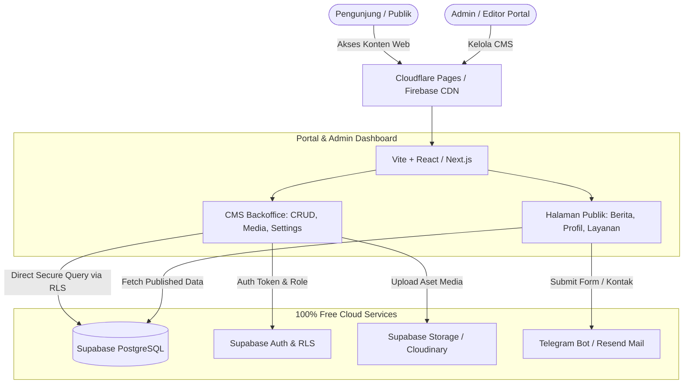
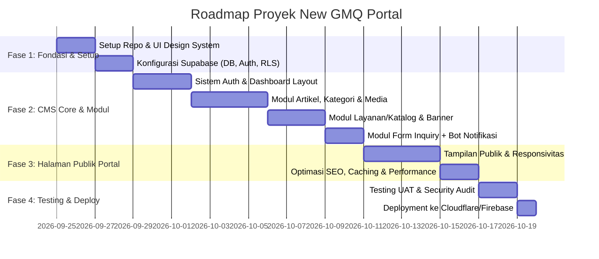

# Blueprint & Perencanaan Teknis: New GMQ Portal (Custom CMS)

Dokumen ini memuat perencanaan arsitektur, perbandingan stack gratis (100% Free-Tier), struktur modul fungsional, dan skema basis data untuk **New GMQ Portal**.

---

## 1. Analisis & Rekomendasi Tech Stack (100% Free Tier)

### Perbandingan Opsi Stack

| Komponen | Pilihan Saat Ini | Rekomendasi Alternatif Terbaik | Mengapa Rekomendasi Lebih Baik? |
| :--- | :--- | :--- | :--- |
| **Database & Auth** | **Supabase** | **Supabase** (Tetap dipertahankan) | PostgreSQL tangguh, Row Level Security (RLS), Auth bawaan, Storage 1 GB gratis, REST/GraphQL API otomatis. *(Catatan: Free project pause jika 7 hari tanpa aktivitas, bisa diatasi dengan auto-ping/cron mingguan)*. |
| **Hosting & CDN** | **Firebase Hosting** | **Cloudflare Pages** *(atau Vercel / Netlify)* | Firebase Hosting free tier membatasi bandwidth (~360MB/hari atau 10GB/bulan). **Cloudflare Pages memberikan UNLIMITED bandwidth** gratis, latency CDN global terdepan di Indonesia, dan integrasi Edge Function tanpa biaya. |
| **Frontend Framework** | SPA / React / Vue murni | **Vite + React (Tailwind/Custom CSS)** atau **Next.js (App Router)** | Untuk CMS portal: <br>• **Vite + React (SPA + SSG)**: Bobot bundle super kecil (<100KB), 100% gratis di Cloudflare Pages/Firebase, tidak butuh server aktif.<br>• **Next.js / Astro**: Jika butuh SEO tingkat tinggi untuk halaman publik portal GMQ. |
| **Storage Media/Gambar** | Supabase Storage | **Supabase Storage** + **Cloudinary (Free)** | Supabase memberi 1GB. Cloudinary memberi ~25 kredit gratis/bulan dengan fitur auto-compress/resize WebP otomatis agar website ultra-cepat. |
| **Notifikasi / Email** | - | **Resend** (3.000 email/bln free) + **Telegram Bot API** (Gratis tanpa batas) | Untuk notifikasi inquiry/pesan masuk atau registrasi user baru langsung ke HP admin secara real-time. |

---

## 2. Arsitektur Solusi Rekomendasi



---

## 3. Modul-Modul Fungsional CMS

CMS dirancang modular agar ringan (*lean core*) namun mudah ditambah modul baru di kemudian hari:

### A. Core Engine (Sistem Inti)
1. **Authentication & RBAC (Role-Based Access Control)**:
   - Role: `Superadmin` (akses penuh), `Editor` (buat & terbitkan konten), `Contributor` (draft saja).
   - Login aman (Email/Password, Magic Link, atau Google Auth).
2. **Site & Global Settings**:
   - Pengaturan logo, favicon, kontak, sosmed, script tracking (Google Analytics, GTM).
   - Maintenance mode switch.

### B. Content & Editorial Module
3. **Article / News & Blog Manager**:
   - Rich Text Editor ringan (TipTap / Blocknote / Quill).
   - Status: Draft, Published, Scheduled, Archived.
   - Kategori & Tags hierarkis.
   - Automatic slug & SEO Meta per artikel (OpenGraph & Schema.org).
4. **Custom Pages Builder (Static/Dynamic Pages)**:
   - Buat halaman kustom (misal: "Tentang Kami", "Kebijakan Privasi", "Karir") dengan komponen modular.
5. **Banner / Hero Slider Manager**:
   - Atur banner promo, headline pengumuman di beranda, tombol CTA, dan masa tayang.

### C. Business & Interactive Module
6. **Layanan / Produk / Portofolio GMQ**:
   - Katalog terstruktur dengan spesifikasi, galeri foto, dan unduhan brosur/dokumen.
7. **Formulir Kontak & Lead Management**:
   - Menampung aspirasi, keluhan, atau penawaran kerja sama.
   - Status lead: *New, In Review, Followed Up, Closed*.
   - Instant Notification ke grup Telegram tim GMQ ketika ada form masuk.
8. **Media Asset Manager**:
   - Galeri file (gambar, PDF), folderisasi, preview, copy URL, dan kompresi gambar otomatis.

### D. Security & Optimization
9. **Activity / Audit Log**:
   - Mencatat aktivitas penting (siapa mengedit/menghapus konten apa dan kapan).
10. **PWA & Caching Support**:
    - Web terasa instan dan hemat kuota bagi pengunjung seluler.

---

## 4. Skema Basis Data Inti (Supabase PostgreSQL)

```sql
-- 1. Profiles & Roles
CREATE TABLE profiles (
  id UUID REFERENCES auth.users ON DELETE CASCADE PRIMARY KEY,
  full_name TEXT NOT NULL,
  role TEXT CHECK (role IN ('superadmin', 'editor', 'contributor')) DEFAULT 'contributor',
  avatar_url TEXT,
  created_at TIMESTAMPTZ DEFAULT NOW()
);

-- 2. Categories
CREATE TABLE categories (
  id UUID PRIMARY KEY DEFAULT gen_random_uuid(),
  name TEXT NOT NULL,
  slug TEXT UNIQUE NOT NULL,
  description TEXT,
  created_at TIMESTAMPTZ DEFAULT NOW()
);

-- 3. Posts / Articles
CREATE TABLE posts (
  id UUID PRIMARY KEY DEFAULT gen_random_uuid(),
  author_id UUID REFERENCES profiles(id) ON DELETE SET NULL,
  category_id UUID REFERENCES categories(id) ON DELETE SET NULL,
  title TEXT NOT NULL,
  slug TEXT UNIQUE NOT NULL,
  excerpt TEXT,
  content JSONB NOT NULL, -- fleksibel untuk rich text / modular blocks
  featured_image TEXT,
  status TEXT CHECK (status IN ('draft', 'published', 'archived')) DEFAULT 'draft',
  published_at TIMESTAMPTZ,
  meta_title TEXT,
  meta_description TEXT,
  views_count INT DEFAULT 0,
  created_at TIMESTAMPTZ DEFAULT NOW(),
  updated_at TIMESTAMPTZ DEFAULT NOW()
);

-- 4. Inquiries / Leads (Form Kontak)
CREATE TABLE inquiries (
  id UUID PRIMARY KEY DEFAULT gen_random_uuid(),
  name TEXT NOT NULL,
  email TEXT NOT NULL,
  phone TEXT,
  subject TEXT,
  message TEXT NOT NULL,
  status TEXT CHECK (status IN ('new', 'in_progress', 'resolved')) DEFAULT 'new',
  created_at TIMESTAMPTZ DEFAULT NOW()
);

-- 5. Site Settings (Key-Value Store fleksibel)
CREATE TABLE site_settings (
  key TEXT PRIMARY KEY,
  value JSONB NOT NULL,
  updated_at TIMESTAMPTZ DEFAULT NOW()
);
```

---

## 5. Roadmap Tahapan Pengembangan


